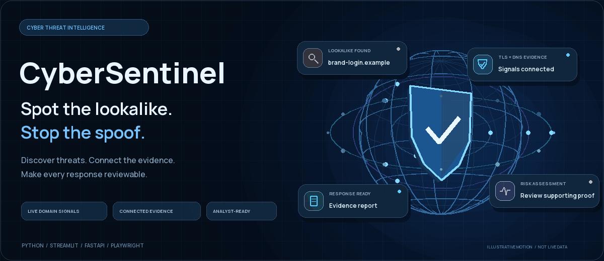

<div align="center">

<picture>
  <source media="(prefers-reduced-motion: reduce)" srcset="docs/assets/cybersentinel-hero-poster.png">
  
</picture>

<sub>Looping 3D illustration with a rotating threat globe and moving signal cards; motion is illustrative, not live monitoring data.</sub>

**Brand impersonation & phishing intelligence, in one workspace.**

Discover lookalike domains, investigate the evidence, and prepare a confident response.

<p align="center">
<a href="https://github.com/asuwathkumaresh07-cyber/CyberSentinel/commits/main"></a> <a href="https://github.com/asuwathkumaresh07-cyber/CyberSentinel/stargazers"></a> <a href="CODE_REVIEW.md"></a> <a href="requirements.txt"></a>
</p>

<p align="center"><a href="#inside-the-workspace">Workspace</a> / <a href="#quick-start">Quick start</a> / <a href="#from-signal-to-response">Workflow</a> / <a href="API.md">API</a> / <a href="#development--verification">Development</a></p>

</div>

---

## Inside the workspace

<a href="docs/assets/dashboard-demo.png">
  
</a>

<sub>Illustrative dashboard workspace using synthetic `.example` domains; it does not display live monitoring telemetry.</sub>

<table>
<tr>
<td width="50%" valign="top">

### Discover the lookalikes

Monitor certificate signals, search historical CT records, and generate domain variants with `dnstwist`. Normalize hostnames and distinguish official domains from suspicious candidates.

</td>
<td width="50%" valign="top">

### Connect the evidence

Collect DNS, HTTP, TLS, WHOIS/RDAP, screenshots, credential-form signals, and perceptual image similarity. Keep findings and supporting observations together.

</td>
</tr>
<tr>
<td width="50%" valign="top">

### Understand the risk

Inspect score breakdowns, severity, confidence, and missing evidence. Certificate events alone do not claim visual similarity or credential theft.

</td>
<td width="50%" valign="top">

### Make the response reviewable

Triage findings, record analyst decisions, generate PDF evidence reports, and prepare registrar notices. Optional notification providers support delivery tracking.

</td>
</tr>
</table>

## From signal to response

<picture>
  <source media="(prefers-reduced-motion: reduce)" srcset="docs/assets/detection-workflow-poster.png">
  
</picture>

| Workspace | What you can do |
| :--- | :--- |
| **Domain Explorer** | Search, filter, sort, and investigate findings in the interactive table or card gallery. |
| **Overview** | Inspect severity distribution, brand exposure, discovery activity, and monitoring counters. |
| **Brand Watchlist** | Manage up to three monitored websites and launch targeted scans. |
| **Live CT Stream** | Follow connection health and sampled certificate activity. |
| **Domain Scanner** | Run on-demand domain discovery and collect investigation evidence. |
| **Simulations** | Explore prepared phishing scenarios and compare visual evidence. |
| **Report Workspace** | Check evidence readiness, generate a PDF, and download it for review. |

## Quick start

### Windows: one launcher

Clone the repository, then double-click **[Launch_CyberSentinel.bat](Launch_CyberSentinel.bat)**.

```powershell
git clone https://github.com/asuwathkumaresh07-cyber/CyberSentinel.git
cd CyberSentinel
.\Launch_CyberSentinel.bat
```

The launcher creates the environment when needed, installs dependencies, and starts the local web services. Keep their service windows open while working.

| Service | Local address |
| :--- | :--- |
| Landing page | [localhost:8765](http://localhost:8765) |
| Analyst dashboard | [localhost:8501](http://localhost:8501) |
| Interactive API documentation | [localhost:8000/docs](http://localhost:8000/docs) |

### Manual setup

The project was verified locally with **Python 3.14.3**. For macOS/Linux, create an environment and run the dashboard from the repository root:

```bash
git clone https://github.com/asuwathkumaresh07-cyber/CyberSentinel.git
cd CyberSentinel
python3 -m venv .venv
source .venv/bin/activate
python -m pip install -r requirements.txt
python -m playwright install chromium
streamlit run app.py
```

Run the API and landing page in separate terminals, with the environment activated:

```bash
python -m uvicorn src.api.main:app --host 127.0.0.1 --port 8000
python landing_page/server.py
```

The local dashboard uses **SQLite by default** and starts its built-in background monitor. PostgreSQL and the full Docker Compose deployment are available for the separate service architecture.

<details>
<summary><b>Environment configuration & Docker</b></summary>

Use [.env.example](.env.example) as a template for a local `.env` file. Set a unique `JWT_SECRET` before using persistent API sessions; set a strong `POSTGRES_PASSWORD` before starting the Docker stack.

```dotenv
DATABASE_URL=sqlite:///data/phishing_detector.db
CERTSTREAM_URL=wss://api.certstream.dev/lite
CORS_ALLOWED_ORIGINS=http://localhost:8501,http://127.0.0.1:8501
```

Generate a random JWT secret locally:

```bash
python -c "import secrets; print(secrets.token_urlsafe(48))"
```

Optional Telegram and SMTP settings are documented in `.env.example`. Keep credentials out of version control.

For the multi-service deployment:

```bash
docker compose up --build
```

See [DEPLOYMENT.md](DEPLOYMENT.md) for deployment details and [BACKUP_RECOVERY.md](BACKUP_RECOVERY.md) for storage recovery.

</details>

## Evidence before conclusions

Scores help prioritize investigation. A valid TLS certificate, a similar domain name, or a high score alone does not establish confirmed phishing.

<details>
<summary><b>How the two scoring paths classify findings</b></summary>

| Scoring path | LOW | MEDIUM | HIGH | CRITICAL |
| :--- | :--- | :--- | :--- | :--- |
| Local dashboard / legacy scorer | Below 50 | 50 to below 70 | 70 and above | Not used |
| Enterprise risk engine / API | Below 30 | 30 to below 60 | 60 to below 80 | 80 and above |

The enterprise engine also returns confidence, reasons, missing evidence, and a recommended action. Review supporting evidence before issuing an abuse report or requesting a takedown.

</details>

## Development & verification

```bash
python -m pytest tests -q
```

**98 tests passed** in the code review, covering API authorization, tenant isolation, storage, monitoring, risk boundaries, redirect safety, report generation, and dashboard navigation. See [CODE_REVIEW.md](CODE_REVIEW.md) for the fixes and validation limits.

Both dashboard entry points were checked across every menu destination. Desktop/mobile browser checks confirmed radar movement, a single visual after refresh, working table rendering, and no horizontal overflow on the checked mobile viewport.

<details>
<summary><b>Frontend builds & animated README assets</b></summary>

The custom table and radar are shipped as compiled Streamlit component assets. Node.js is needed when changing that frontend:

```bash
cd components/phishshield-threat-grid/phishshield_threat_grid/frontend
npm ci
npm run build
```

The standalone React hero prototype can be rebuilt separately:

```bash
cd designpro_hero
npm ci
npm run build
```

The README animations are original, locally rendered GIFs. The hero loops a rotating 3D threat globe with moving signal cards and orbiting icons; GitHub renders it as an animation, not a pointer-controlled canvas. Regenerate the animations from the repository root:

```bash
python docs/render_readme_visuals.py
```

Each animation includes a static poster for reduced-motion image selection. The animations do not require a third-party animation service or access to project credentials.

</details>

<details>
<summary><b>Project map</b></summary>

```text
app.py                 Local Streamlit dashboard
dashboard/app.py       Enterprise dashboard
landing_page/          Landing page and its local server
src/api/               FastAPI routes, schemas, and authentication
src/discovery/         Domain variants and historical CT discovery
src/ingest/            Certificate-stream workers and telemetry
src/investigation/     Multi-signal domain investigation
src/enrichment/        Screenshots, content, WHOIS, DNS, and network guards
src/scoring/           Risk scoring and evidence explanations
src/reporting/         PDF report generators
src/storage/           SQLAlchemy models and database helpers
src/ui/                Shared glass theme, charts, and navigation
components/            Packaged interactive table and radar
tests/                 Regression and integration tests
docs/assets/           README motion graphics and demo preview
```

</details>

---

<div align="center">

**Discover the signal. Inspect the evidence. Protect the brand.**

[Architecture](ARCHITECTURE.md) &nbsp; / &nbsp; [API reference](API.md) &nbsp; / &nbsp; [Troubleshooting](TROUBLESHOOTING.md) &nbsp; / &nbsp; [Code review](CODE_REVIEW.md)

</div>
